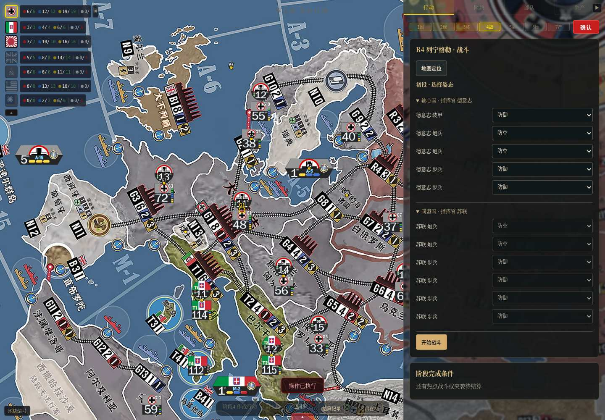
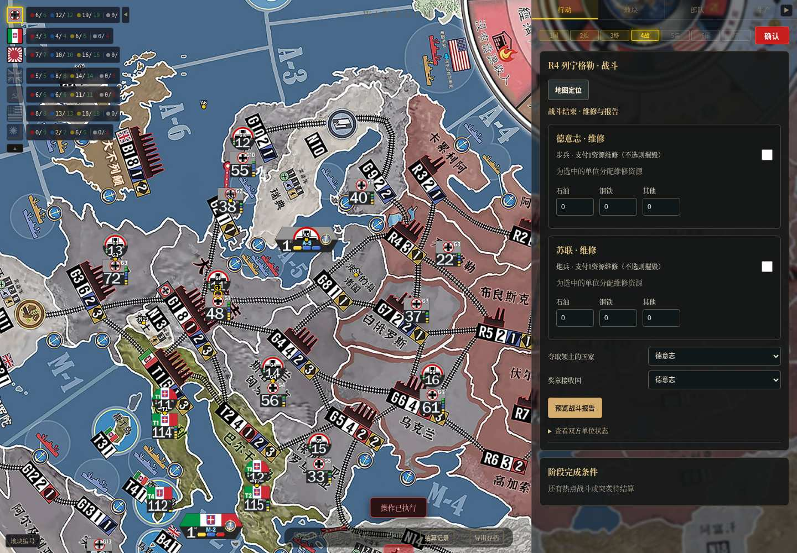
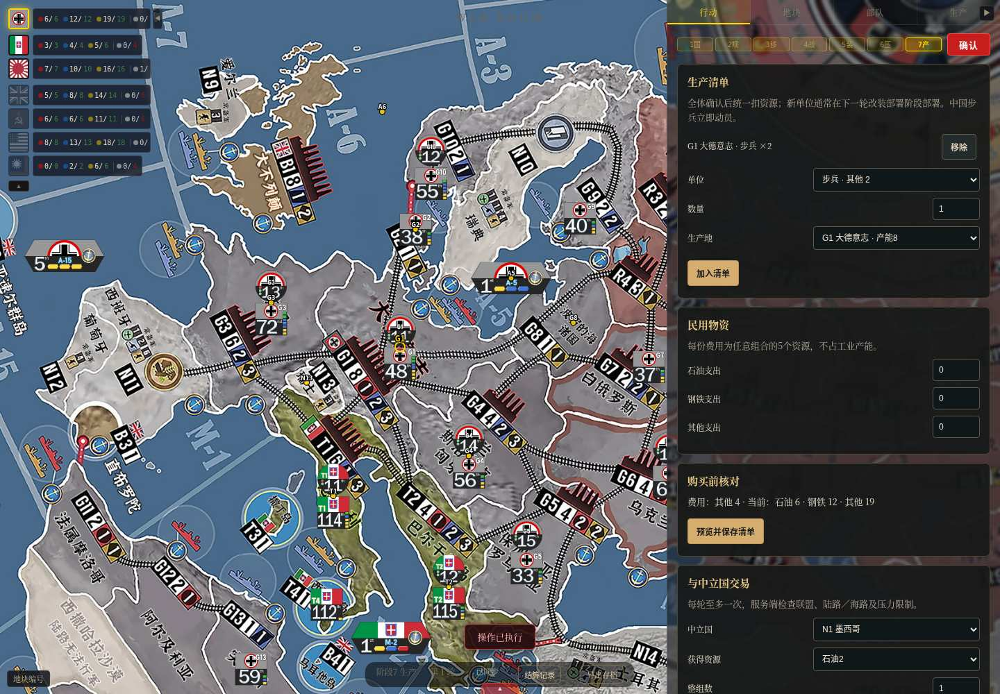
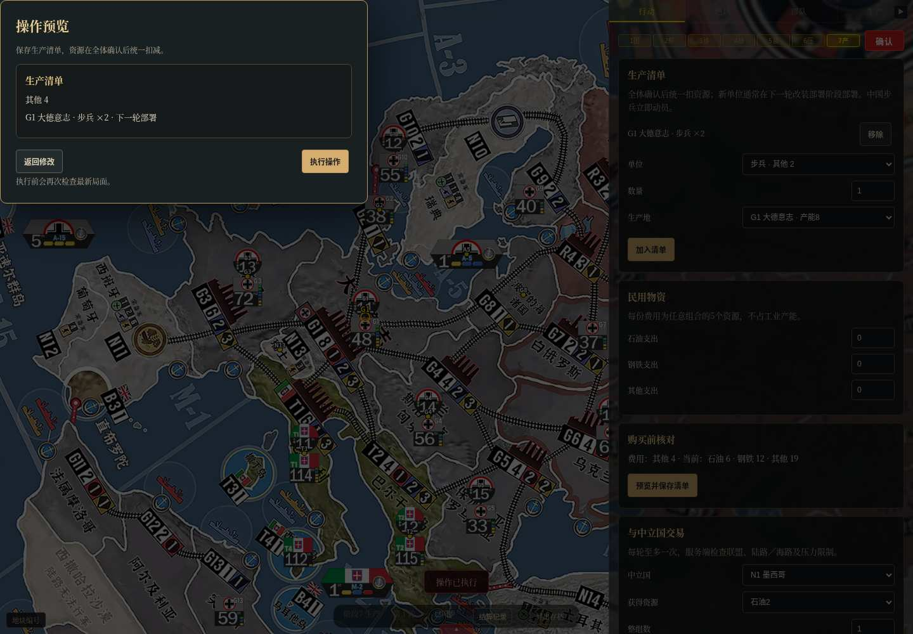
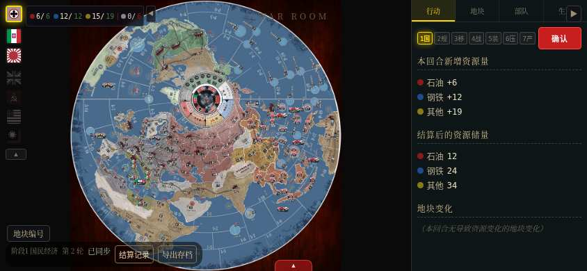

# 界面与结算效果审阅

保留原来的世界地图、国旗视角和右侧“行动／地块／部队／生产”四页。新增内容集中在当前阶段的行动页，手机横屏与小分辨率保持右侧操作面板，缩小面板、控件和间距。

## 先看这三个流程

1. **战斗**：按回合顺位选择热点 → 每个单位选姿态 → 分批投骰 → 按颜色点选合法目标 → 选择维修和资源 → 预览战斗报告 → 执行。命中会立即更新伤损，正式战斗报告更新世界地图、领土、伤亡、奖章和压力。
2. **生产**：选择兵种、数量、生产地 → 加入清单 → 选择民用物资资源组合 → 预览并保存 → 全体确认。预览显示费用与部署时间；正式结算扣资源，下一轮显示待部署单位。
3. **压力**：查看自动伤亡转换 → 逐国提交消除压力数量 → 全体完成后自动评估等级 → 逐国决定缓解 → 支付维稳资源 → 必要时选择叛逃单位。每一步均有预览，已提交的选择不会被后续国家回溯修改。

## 界面截图

截图来自实际本机浏览器测试，展示测试局而非固定美术稿。为了跑通回合，自动化测试在部分战斗中选择不维修；这是玩家选择，不是自动摧毁策略。

### 战斗初设

### 战斗报告与维修

### 生产清单

### 生产费用与部署时间预览

### 手机横屏操作面板（844×390）

## 后续界面需要你重点审阅的项目

- 姿态和命中目前按单个单位选择；是否需要“同番号批量设姿态”，作为后续效率改进。
- 战后维修是复选框加资源组合；预览会明确显示未维修造成的伤亡。
- 手机横屏（844×390）和小分辨率（640×360）缩小右侧面板及控件，可通过右上角按钮收起；操作区始终保留在右侧。
- 游戏始终是共享单局，任意用户可切换国旗；如果要转为竞技联机，需要另行确定席位、权限和秘密指令展示方式。
